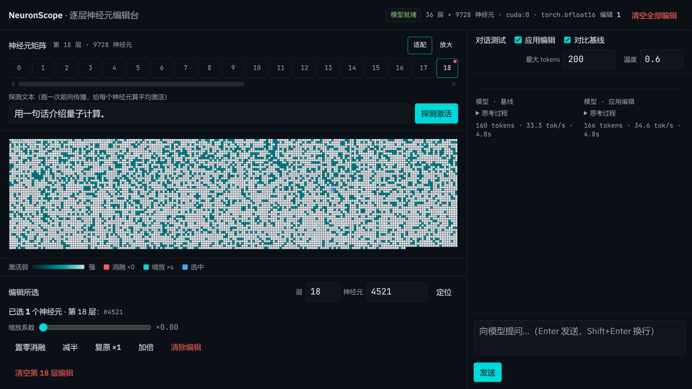

# NeuronScope · 逐层神经元编辑台

针对 **Qwen3-4B-Thinking-2507** 的逐层神经元（SwiGLU 中间维）在线编辑与测试工具：
把每一层的 9728 个神经元画成可点击的矩阵，对任意神经元做缩放/消融，然后直接和模型对话对比行为变化。



## 原理

对每层 MLP 的 `down_proj` 注册 forward-pre-hook——它的输入正是 SwiGLU 神经元激活
`silu(gate_proj(x)) * up_proj(x)`（形状 `[B, S, 9728]`）。把指定下标的激活乘以 scale 即完成编辑：

- `×0` = 消融（ablate）
- `×1` = 原样
- `>1` = 放大

所有编辑实时持久化到 `edits.json`，重启不丢。

## 功能

- **神经元矩阵**：按层浏览全部神经元；"探测激活"跑一次前向，按平均激活强度着色（层内相对值）
- **编辑交互**：单击选中、Ctrl+单击多选、Shift+单击范围选择、双击快速消融/恢复；滑杆 0–2 连续调 scale
- **对话测试**：SSE 流式输出，`<think>` 内容折叠显示；"对比基线"同屏双栏对比编辑前后两份回答；可随时停止
- 显存需求：bf16 约 8 GB（RTX 5090 32G 实测 ~30 tok/s）

## 安装与运行

```bash
./install.sh        # 创建 .venv 并装依赖（torch/transformers 已装则跳过），构建前端 CSS
./server.sh start   # nohup 后台启动，默认 http://127.0.0.1:8788
```

控制命令：

```bash
./server.sh {start|stop|restart|status|log [N]|logf|fg}
```

| 环境变量 | 默认 | 说明 |
|---|---|---|
| `NEURON_MODEL_PATH` | `Qwen/Qwen3-4B-Thinking-2507` | 模型路径或 HF repo id |
| `NEURON_PORT` | `8788` | 监听端口 |
| `NEURON_HOST` | `127.0.0.1` | 监听地址 |

默认从 HuggingFace 拉取模型；本地已有权重时，新建不入 git 的 `.env.local`：

```bash
echo 'export NEURON_MODEL_PATH=/path/to/Qwen3-4B-Thinking-2507' > .env.local
```

## API 摘要

| 方法 | 路径 | 说明 |
|---|---|---|
| GET | `/api/info` | 模型信息 + 当前编辑 |
| PUT | `/api/edits` | 设置单个编辑 `{layer, neuron, scale}`（scale=null 移除） |
| POST | `/api/edits/batch` | 批量编辑 |
| DELETE | `/api/edits[/{layer}]` | 清空全部 / 某层 |
| PUT | `/api/edits/enabled` | 编辑总开关 |
| POST | `/api/probe` | 前向探测，返回每层神经元平均激活（u8 归一化） |
| POST | `/api/chat` | SSE 流式对话（`use_edits` 控制是否应用编辑） |

## 技术栈

FastAPI + PyTorch/Transformers（后端），原生 JS + Canvas + Tailwind CSS v4（前端，无框架）。
